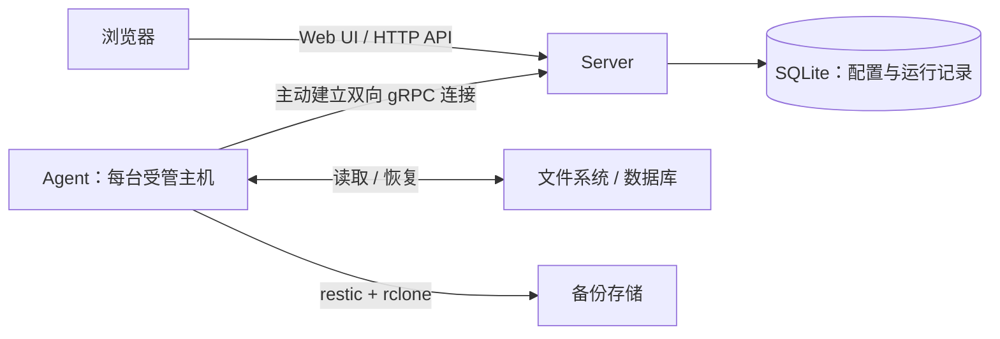

# Backup Management Center

Backup Management Center（BMC）是一个 Server/Agent 架构的备份管理系统，用于集中管理多台主机的文件与数据库备份、快照、恢复及运行记录。

Server 提供 Web 控制台、HTTP API 和任务调度；Agent 在受管主机上执行备份与恢复，主动向 Server 建立出站连接，无需开放 Agent 入站管理端口。

> 部署、配置和升级的权威说明见 [部署文档](deploy/README.md)。本文件提供项目概览和开发入口，不替代生产运维说明。

## 主要功能

- **备份类型**：文件系统、PostgreSQL、MySQL/MariaDB、MongoDB、SQLite。
- **计划与执行**：cron 定时计划、手动触发、运行取消及保留策略。
- **快照与恢复**：快照浏览、文件目录预览、恢复预演，以及同一 Agent 或跨 Agent 恢复。
- **存储与校验**：基于 restic 管理快照仓库，通过 rclone 接入存储后端，支持仓库完整性校验。
- **过程可见**：查看运行状态、当前步骤、进度百分比、已完成大小、总大小和实时日志。
- **运维能力**：Agent 在线状态与工具能力探测、审计记录、Prometheus 指标及 Telegram 失败通知。
- **Web 界面**：React 控制台，支持简体中文和英文。

## 架构



后端使用 Go、gRPC 和 SQLite；前端使用 React 19、TypeScript、Vite 6、Tailwind CSS 4 和 shadcn/ui。生产构建将 Web 静态资源嵌入 Server 二进制。

## 快速开始：Docker Compose

以下流程适用于**新部署**。准备 Linux 主机、Docker Engine 24+ 和 Docker Compose v2；命令使用 POSIX shell，在仓库根目录执行。已有实例升级请先阅读 [部署文档](deploy/README.md) 中的迁移与备份要求。

### 1. 启动 Server

推荐由外部反向代理终止公网 TLS。默认 Compose 只将 Web/API 和 gRPC 分别发布到宿主机的 `127.0.0.1:8080`、`127.0.0.1:9090`，不会直接对外开放。

先配置反向代理和证书：Web/API 转发到 `8080`，Agent 控制通道转发到 `9090`，后者必须支持 HTTP/2 gRPC。不要只代理 Web 页面而遗漏 gRPC。

```sh
cp deploy/.env.example deploy/.env
# 编辑 deploy/.env，将 BMC_PUBLIC_URL 设置为实际访问地址
# 例如：https://backup.example.com

docker compose --env-file deploy/.env -f deploy/docker-compose.yml up -d

# 将示例域名替换为实际域名；就绪检查应返回 HTTP 200
curl --fail https://backup.example.com/health/ready
```

访问配置的 `BMC_PUBLIC_URL`，按 Web 引导创建管理员账号，再在 Agent 管理页面生成一次性注册令牌。

### 2. 注册 Agent

在每台受管主机上准备本仓库，并在该主机的仓库根目录执行：

```sh
cp deploy/.env.agent.example deploy/.env.agent
# 编辑 deploy/.env.agent：
# - BMC_SERVER_GRPC_URL：可访问的 gRPC 地址，必须包含 scheme
#   例如：https://backup.example.com:9090
# - BMC_ENROLLMENT_TOKEN：Web UI 生成的一次性注册令牌
# 同时按需调整 deploy/docker-compose.agent.yml 中的宿主机目录挂载

docker compose --env-file deploy/.env.agent -f deploy/docker-compose.agent.yml up -d --build
```

源目录应只读挂载，恢复输出目录应读写挂载。默认容器路径与配置约定：

| 配置 | 用途 |
| --- | --- |
| `BMC_SOURCE_ROOTS` | 备份源根目录，默认 `/backup-sources`；支持多个根目录，以逗号分隔 |
| `BMC_RESTORE_ROOT` | 恢复根目录，默认容器路径为 `/backup-restore`；仅支持一个根目录 |

默认模板将宿主机 `/etc`、`/srv` 分别挂载到 `/backup-sources/etc`、`/backup-sources/srv`。路径映射及自定义挂载说明见 [部署文档](deploy/README.md)。

首次注册成功后，清空 `.env.agent` 中的 `BMC_ENROLLMENT_TOKEN`，再执行以下命令重建容器；保留原 Agent 状态卷以延续身份：

```sh
docker compose --env-file deploy/.env.agent -f deploy/docker-compose.agent.yml up -d
```

### 3. 执行第一次备份

在 Web UI 中确认 Agent 在线，配置存储目标与备份计划，然后手动触发一次备份。在运行详情中查看进度与日志，确认运行成功并生成真实快照 ID，再到快照页面检查备份内容。

数据库恢复默认禁用；启用前必须在隔离实例上验证预备份与回滚，再按数据库类型配置 `BMC_DATABASE_RESTORE_KINDS`。恢复范围、覆盖确认与人工恢复流程见 [部署文档](deploy/README.md)。

## 本地开发

### 环境要求

| 工具 | 要求 |
| --- | --- |
| Go | `1.27`，以 [go.mod](go.mod) 为准 |
| Node.js | 建议使用 `22`，与 [Server 镜像构建](Dockerfile.server) 保持一致 |
| pnpm | `10.16.1`，以 [web/package.json](web/package.json) 为准 |
| Make / shell | GNU Make 和 POSIX shell；Windows 的 Makefile 使用 `C:/tools/git/usr/bin/sh.exe`，并通过 `cmd.exe /c pnpm` 调用 pnpm |
| protobuf 工具 | 仅修改协议并重新生成代码时需要 `protoc`、`protoc-gen-go`、`protoc-gen-go-grpc` |

直接在宿主机运行 Agent 时，还需自行安装 restic、rclone 和对应数据库客户端；生产 Agent 镜像已包含这些工具。

### 启动开发环境

终端一：先构建嵌入式 Web 资源，再启动 Server。

```sh
make web-build
make dev-server
```

终端二：启动前端开发服务器。

```sh
cd web
pnpm --ignore-workspace run dev
```

访问 `http://127.0.0.1:5178`，完成管理员初始化并生成 Agent 注册令牌。终端三在仓库根目录启动 Agent，将示例令牌替换为实际值：

```sh
BMC_ENROLLMENT_TOKEN='<一次性注册令牌>' make dev-agent
```

`make dev-server` 使用 HTTP `8080` 和 gRPC `9091`，并开启仅限本地开发的 `BMC_DEV_INSECURE=1`；`make dev-agent` 连接本机 `9091`。开发时不要设置 `BMC_PUBLIC_URL`，Vite 会将 `/api/v1` 和 `/ws` 代理到 `127.0.0.1:8080` 并处理同源校验所需的 Origin。

### 常用命令

除前端单独构建命令外，均在仓库根目录执行；Go 构建使用 `CGO_ENABLED=0`。

| 命令 | 作用 |
| --- | --- |
| `make web-build` | 安装前端依赖、构建 Web，并复制到 `internal/server/webui/dist` |
| `CGO_ENABLED=0 make build` | 先构建 Web，再生成 Server 和 Agent 二进制到 `bin/` |
| `make build-linux` | 构建 Web 并交叉编译 Linux amd64 二进制 |
| `make test` | 运行全部 Go 测试：`go test ./... -count=1` |
| `make generate` | 根据 `api/proto/v1/agent.proto` 重新生成 Go 协议代码 |
| `make docker-build` | 构建 Server 和 Agent 镜像 |
| `cd web && pnpm --ignore-workspace run build` | 校验中英文 locale keys、执行 TypeScript 类型检查并构建前端 |

当前没有配置可执行的 lint 目标，也没有前端 test script；不要使用 `make lint` 或 `pnpm test` 作为验证命令。

## 目录导航

| 路径 | 内容 |
| --- | --- |
| [cmd/server/](cmd/server/) | Server 入口、依赖装配和生命周期 |
| [cmd/agent/](cmd/agent/) | Agent 入口与启动配置 |
| [internal/model/](internal/model/) | 共享领域模型、运行状态和稳定错误码 |
| [internal/server/](internal/server/) | HTTP API、认证、调度、SQLite 持久化与 gRPC 调度 |
| [internal/agent/](internal/agent/) | Agent 连接、任务执行、备份适配器与工具封装 |
| [api/proto/v1/](api/proto/v1/) | Server/Agent 协议及生成代码 |
| [web/](web/) | React Web UI、API client、路由和中英文文案 |
| [deploy/](deploy/) | Compose、环境变量示例、systemd 单元和权威部署文档 |

## 数据安全与运维

- **备份 Server 数据和主密钥**：默认数据位于 `bmc-data` 卷的 `/var/lib/bmc`，主密钥为 `master.key`。丢失主密钥后无法解密已有存储凭据；迁移或恢复数据库时必须保留匹配的原密钥。
- **保留 Agent 身份**：`bmc-agent-state` 卷保存身份、缓存与暂存数据，不可在多台主机间共享。
- **不要删除持久化卷**：日常停机使用 `docker compose down`，不要使用 `down -v`。
- **保护敏感信息**：不要提交真实 `.env`、注册令牌、数据库密码、存储凭据、主密钥或 TLS 私钥。
- **确认跨 Agent 存储可达**：目标 Agent 必须能访问来源仓库；节点本地的 `local` 后端不能直接用于不同主机之间的恢复。
- **遵守升级顺序**：先升级 Server，通过 `/health/ready` 后再滚动升级 Agent。数据库迁移、备份位置、回滚边界、systemd 部署与管理员密码重置均以 [部署文档](deploy/README.md) 为准。
